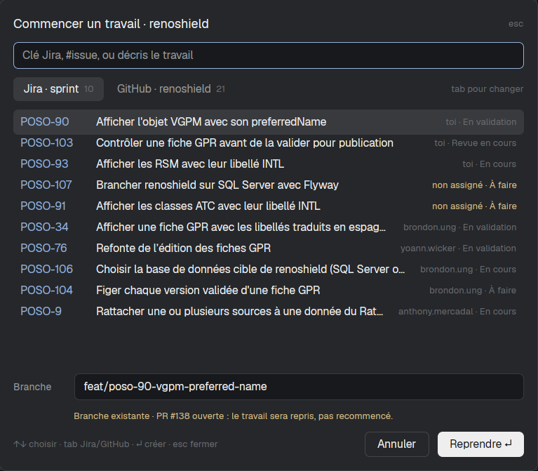
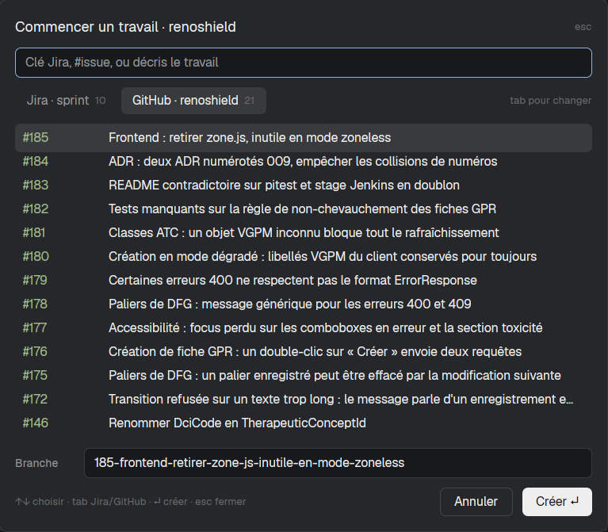

# herdr-config

Ma configuration de [Herdr](https://herdr.dev). Le repo vit directement dans `~/.config/herdr-app`. Le `.gitignore` ne suit que mes fichiers, et laisse de côté tout ce que Herdr écrit lui-même : l'état de la fenêtre, les mods et layouts fournis par l'app, les types générés.

| Fichier | Rôle |
|---|---|
| `keys.json` | mes raccourcis (`ctrl-shift-j` ouvre start-work) |
| `settings.json` | mes réglages |
| `mods/start-work/` | la fenêtre « Commencer un travail » |
| `install.sh` | installe et vérifie ce dont les mods ont besoin |

## start-work

`ctrl-shift-j`, depuis un terminal ouvert dans un repo :

| Jira : POSO-90 a déjà sa branche et sa PR, Créer devient Reprendre | GitHub : les issues du repo |
|---|---|
|  |  |

- l'onglet **Jira** liste les tickets ouverts du repo (voir plus bas d'où ils viennent) : d'abord les miens, puis ceux sans personne, puis ceux des autres. Une clé tapée en entier (`POSO-110`) est cherchée dans tout Jira ;
- l'onglet **GitHub** liste les issues ouvertes du repo ;
- `tab` passe d'un onglet à l'autre. Taper `#12` ouvre GitHub, une clé ouvre Jira. Un texte libre donne un travail « sans ticket ».

**Créer** fait un worktree dans `~/.herdr/worktrees/<repo>/<branche>`, à partir de `origin/HEAD`. Il ouvre dessus un espace avec Claude. Pour un ticket Jira qui n'est pas à moi, la case « M'assigner » (cochée par défaut) me l'assigne, et le passe « En cours » s'il était encore à faire.

Si le ticket a déjà une branche ou une PR ouverte, le bouton devient **Reprendre** : il ouvre cette branche au lieu d'en créer une, ou affiche l'espace qui est déjà dessus.

La première fois qu'on ouvre un repo, l'onglet Jira demande où sont ses tickets, et la réponse est gardée dans `mods/start-work/config.json`. Un repo peut en avoir plusieurs : sous les onglets, « Tickets de : » les liste. Un clic sur l'un le modifie, × le retire, « + ajouter » en ajoute un, et leurs tickets s'affichent ensemble. On peut donner :

| Réponse | Tickets montrés |
|---|---|
| le lien d'un board de projet (`…/projects/POSO/boards/1802`) ou la clé (`POSO`) | ceux du sprint ouvert du projet, ou tous ses tickets ouverts s'il n'a pas de sprint (kanban) |
| le lien d'un filtre (`…/issues/?filter=10782`) | les tickets ouverts du filtre |
| du JQL (`labels = DATADELTA`) | les tickets ouverts qu'il trouve |

On choisit le board qu'on veut. Pour un board qui n'appartient pas à un projet (Table Ronde : `…/people/…/boards/96`), on colle le lien de son filtre, ce sont les mêmes tickets : sur le board, ⋯ → Paramètres du tableau → Filtre → Modifier la requête de filtre. acli ne sait pas retrouver ce filtre à partir du board. Pour n'avoir que la part d'un repo dans un grand board, du JQL suffit (`labels = DATADELTA`). `config.json` donne aussi le format des branches de certains repos :

```json
"jira": { "renoshield": "https://vidalgroup.atlassian.net/jira/software/projects/POSO/boards/1802", "data-delta": ["labels = DATADELTA", "https://vidalgroup.atlassian.net/issues/?filter=10782"] },
"branch_formats": { "renoshield": "feat/{key}-{slug}" }
```

Dans un format, `{KEY}` vaut `POSO-12`, `{key}` vaut `poso-12` et `{slug}` est le titre du ticket. Sans format, une branche s'appelle `POSO-12-titre`.

## Prérequis

```bash
~/.config/herdr-app/install.sh
```

Le script :

- vérifie `git` ;
- vérifie `gh` et le connecte si besoin ;
- installe `acli`, le CLI officiel d'Atlassian, dans `~/.local/bin` (Linux, sans sudo) s'il manque, puis le connecte à Jira avec `acli jira auth login --web` (OAuth dans le navigateur, sans token) ;
- lance `herdr-app check` sur chaque mod.

On peut le relancer sans risque.

## Sur une autre machine

`~/.config/herdr-app` existe déjà dès que Herdr a été lancé une fois. On y récupère donc le repo, sans cloner par-dessus :

```bash
cd ~/.config/herdr-app
git init -b main && git remote add origin <url-du-repo>
git fetch origin && git checkout -f main
./install.sh
```

## Installer start-work

Pour ajouter seulement le mod à son Herdr, sans les raccourcis ni les réglages de ce repo. Deux façons.

### En demandant à son agent

Comme sur [herdr.dev/mods](https://herdr.dev/mods), on copie une ligne à son agent dans Herdr. Il suit la procédure du guide de Herdr (`~/.config/herdr-app/AGENTS.md`) : lire chaque fichier avant d'ajouter le mod, le copier sans écraser un mod du même nom, ajouter la touche en demandant avant d'en remplacer une, puis lancer `herdr-app check`.

```text
Read ~/.config/herdr-app/AGENTS.md, then add this mod: github.com/aguiddir/herdr-config/tree/main/mods/start-work. Bind ctrl-shift-j to mod.open:start-work. It needs gh and acli (Atlassian's CLI) logged in: run install.sh from that repo.
```

### À la main


```bash
git clone https://github.com/aguiddir/herdr-config.git ~/herdr-config
cp -r ~/herdr-config/mods/start-work ~/.config/herdr-app/mods/
~/herdr-config/install.sh   # installe acli, connecte gh et acli, vérifie le mod
```

Puis ajouter le raccourci dans la section `global` de `~/.config/herdr-app/keys.json` :

```json
"ctrl-shift-j": "mod.open:start-work"
```

Le premier lancement dans un repo, l'onglet Jira demande où sont ses tickets (voir plus haut).

Pour mettre à jour : `git -C ~/herdr-config pull`, puis refaire le `cp`. Il remplace `config.json` : les sources de tickets données dans l'onglet Jira seront à redonner.
