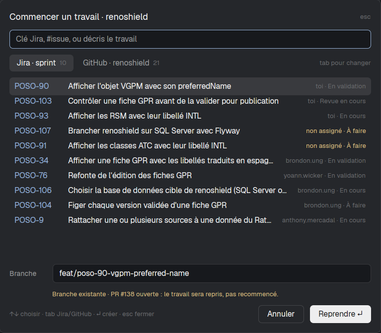
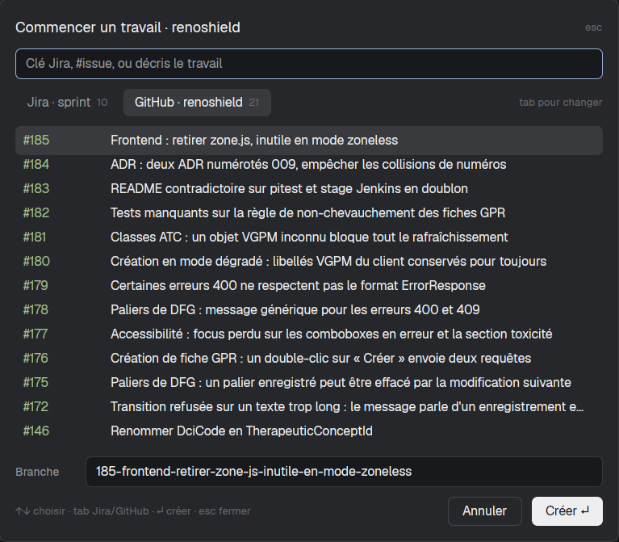
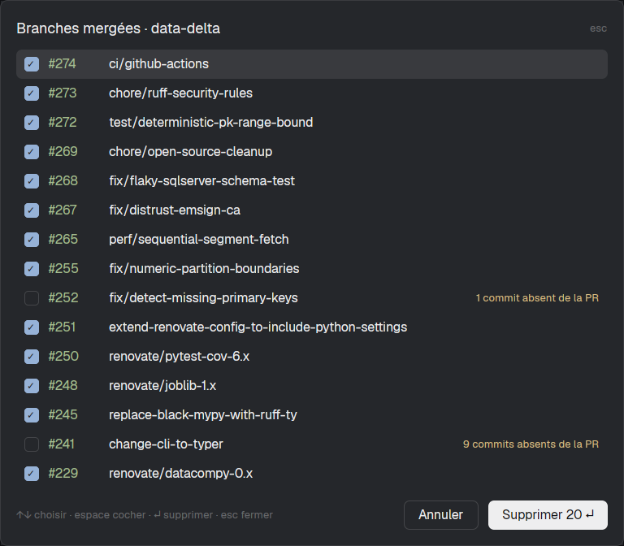
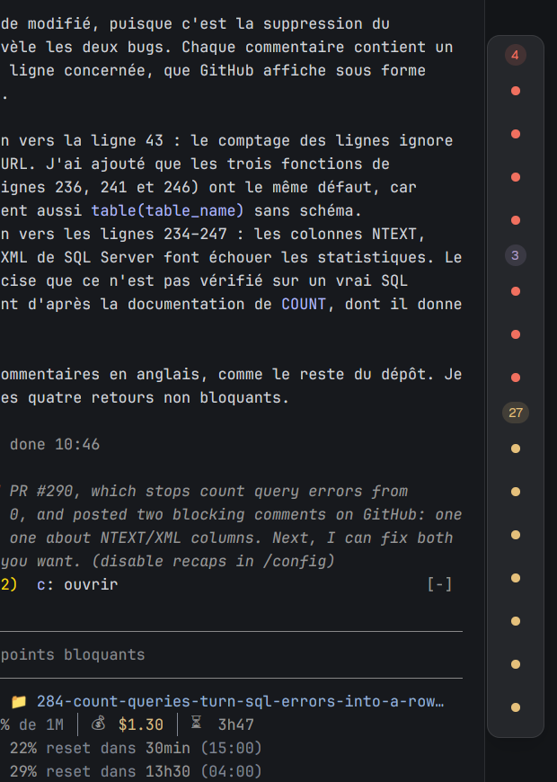
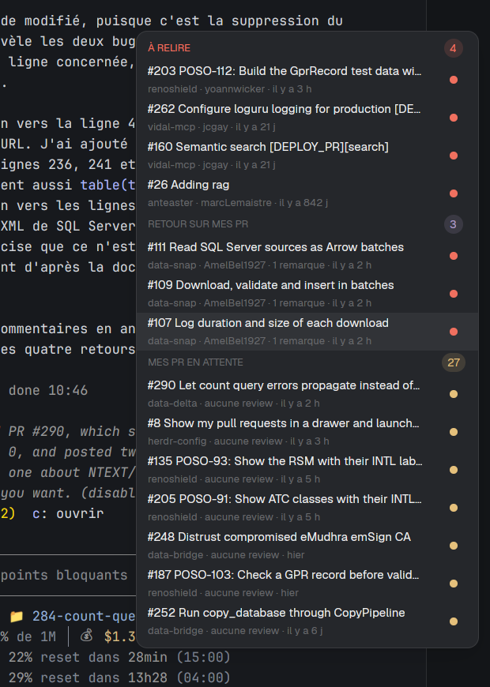
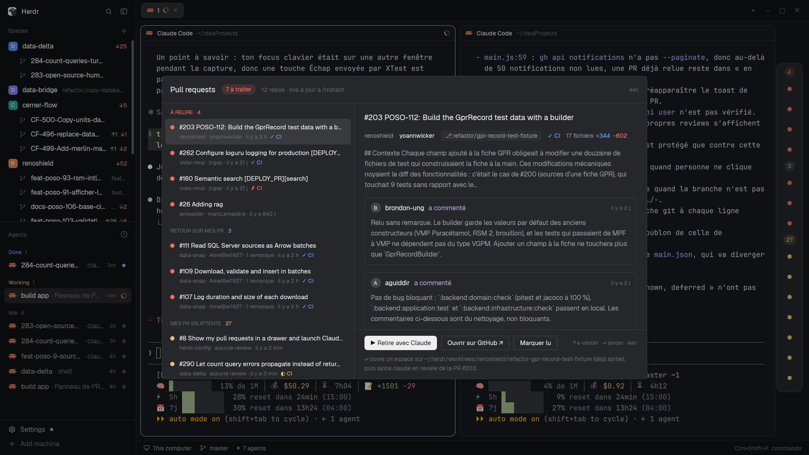

# herdr-config

Ma configuration de [Herdr](https://herdr.dev). Le repo vit directement dans `~/.config/herdr-app`. Le `.gitignore` ne suit que mes fichiers, et laisse de côté tout ce que Herdr écrit lui-même : l'état de la fenêtre, les mods et layouts fournis par l'app, les types générés.

| Fichier | Rôle |
|---|---|
| `keys.json` | mes raccourcis (`ctrl-shift-j` ouvre start-work) |
| `settings.json` | mes réglages |
| `mods/start-work/` | la fenêtre « Commencer un travail » |
| `install.sh` | installe et vérifie ce dont les mods ont besoin |
| `mods/clean-merged/` | le panneau qui supprime les branches et worktrees des PR mergées (`ctrl-shift-m`) |
| `mods/pr-inbox/` | les PR GitHub qui m'attendent : un tiroir sur le bord droit, un toast quand une review tombe, et un Claude lancé sur la PR (`ctrl-shift-g`) |
| `layouts/mine.json` | mon layout : `main` plus le tiroir des PR |
| `mods/pipeline/` | lancer des agents sur des tickets Jira et voir où ils en sont : codeur, relecteur, PR (`ctrl-shift-a`) |
| `hc-templates/` | les rôles herdr-core que `install.sh` installe : le relecteur du pipeline |

## start-work

`ctrl-shift-j`, depuis un terminal ouvert dans un repo :

| Jira : POSO-90 a déjà sa branche et sa PR, Créer devient Reprendre | GitHub : les issues du repo |
|---|---|
|  |  |

- l'onglet **Jira** liste les tickets ouverts du repo (voir plus bas d'où ils viennent) : d'abord les miens, puis ceux sans personne, puis ceux des autres. Une clé tapée en entier (`POSO-110`) est cherchée dans tout Jira ;
- l'onglet **Issues** liste les issues ouvertes du repo ;
- l'onglet **PR** liste les PR ouvertes : choisir une PR ouvre un worktree sur sa branche, pour la relire ou la modifier (celle d'un fork est récupérée par `pull/<n>/head`) ;
- `tab` passe à l'onglet suivant, `shift-tab` au précédent. Taper `#12` ouvre Issues (sauf depuis PR), une clé ouvre Jira. Un texte libre donne un travail « sans ticket ».

**Créer** fait un worktree dans `~/.herdr/worktrees/<repo>/<branche>`, à partir de `origin/HEAD`. Il ouvre dessus un espace avec Claude. Pour un ticket Jira qui n'est pas à moi, la case « M'assigner » (cochée par défaut) me l'assigne, et le passe « En cours » s'il était encore à faire.

Si le ticket a déjà une branche ou une PR ouverte, le bouton devient **Reprendre** : il ouvre cette branche au lieu d'en créer une, ou affiche l'espace qui est déjà dessus.

La première fois qu'on ouvre un repo, l'onglet Jira demande où sont ses tickets, et la réponse est gardée dans `mods/start-work/config.json`. Un repo peut en avoir plusieurs : sous les onglets, « Tickets de : » les liste. Un clic sur l'un le modifie, × le retire, « + ajouter » en ajoute un, et leurs tickets s'affichent ensemble. On peut donner :

| Réponse | Tickets montrés |
|---|---|
| le lien d'un board de projet (`…/projects/POSO/boards/1802`) ou la clé (`POSO`) | ceux du sprint ouvert du projet, ou tous ses tickets ouverts s'il n'a pas de sprint (kanban) |
| le lien d'un filtre (`…/issues/?filter=10782`) | les tickets ouverts du filtre |
| du JQL (`labels = DATADELTA`) | les tickets ouverts qu'il trouve |

On choisit le board qu'on veut. Pour un board qui n'appartient pas à un projet (Table Ronde : `…/people/…/boards/96`), on colle le lien de son filtre, ce sont les mêmes tickets : sur le board, ⋯ → Paramètres du tableau → Filtre → Modifier la requête de filtre. acli ne sait pas retrouver ce filtre à partir du board. Pour n'avoir que la part d'un repo dans un grand board, du JQL suffit (`labels = DATADELTA`). `config.json` donne aussi le format des branches de certains repos :

```json
"jira": { "renoshield": "https://vidalgroup.atlassian.net/jira/software/projects/POSO/boards/1802", "data-delta": ["labels = DATADELTA", "https://vidalgroup.atlassian.net/issues/?filter=10782"] },
"branch_formats": { "renoshield": "feat/{key}-{slug}" }
```

Dans un format, `{KEY}` vaut `POSO-12`, `{key}` vaut `poso-12` et `{slug}` est le titre du ticket. Sans format, une branche s'appelle `POSO-12-titre`.

## clean-merged

`ctrl-shift-m`, depuis un terminal ouvert dans un repo, liste ses branches locales dont la PR GitHub est mergée. `↵` supprime celles qui sont cochées, avec leur worktree et l'espace Herdr ouvert dessus.



- cochées d'office : tous leurs commits sont dans la PR. Les squash merges sont gérés : la branche est comparée au head de la PR, pas à `main` ;
- décochées : la branche a des commits absents de la PR (travail ajouté après le merge, ou branche rebasée depuis). On peut les cocher quand même ;
- grisées : le worktree a des changements non commités, un agent y travaille, ou un terminal y est ouvert depuis un espace qui a aussi des terminaux ailleurs (à fermer soi-même).

La branche par défaut, celle du checkout principal et celles dans lesquelles une PR a été mergée (`develop`, `release/…`) ne sont jamais proposées, ni les branches des PR venues d'un fork. Une branche qui a changé depuis l'ouverture du panneau n'est pas supprimée.

Les espaces fermés sont ceux dont tous les terminaux sont dans le worktree. Le worktree est retiré sans `--force`, mais ses fichiers ignorés par git (un `.env`, par exemple) partent avec lui. Une branche supprimée ne se retrouve pas dans le reflog : seulement par `git fsck --unreachable`, tant que git n'a pas fait le ménage.

## pr-inbox

Un tiroir flottant sur le bord droit de la fenêtre (layout `mine`) : replié, 52 px, un compteur par section et un point par PR ; il s'ouvre au survol. `ctrl-shift-g`, ou un clic sur une ligne, ouvre le dialogue.

| Le tiroir, replié | Le tiroir, ouvert |
|---|---|
|  |  |



Trois sections, tous repos confondus :

| Section | D'où ça vient |
|---|---|
| **À relire** : les PR des autres où ma review est demandée | `gh search prs --review-requested=@me` |
| **Retour sur mes PR** : mes PR avec une review ou un commentaire pas encore lu | `gh api notifications` |
| **Mes PR en attente** : mes autres PR ouvertes (en vert : approuvée) | `gh search prs --author=@me` |

Le tiroir interroge GitHub toutes les 90 s. Une notification jamais vue donne un toast (« X te demande une review », « Y a relu #N ») ; le cliquer ouvre le dialogue sur la PR. Au premier lancement rien n'est signalé : ce qui existait déjà est marqué vu.

Le dialogue : la liste à gauche, la PR à droite, avec sa branche, sa CI, ses fichiers, puis chaque review avec son verdict et ses commentaires `fichier:ligne`, en lecture seule. Répondre se fait sur GitHub (« Ouvrir sur GitHub ↗ »). « Marquer lu » marque lues les notifications de la PR.

- `↑↓` choisit, `↵` lance, `o` ouvre la PR sur GitHub, `r` la marque lue, `esc` ferme ;
- **▶ Relire avec Claude**, sur une PR à relire : la branche est sortie dans un worktree (`pull/<n>/head` pour un fork), un espace ouvert dessus, et Claude lancé avec « relis la PR #N : `/code-review high --comment`, puis `gh pr review --comment` s'il y a des trouvailles, `--approve` sinon ». La review est postée en mon nom, et la PR quitte « À relire » au poll suivant. La branche est à quelqu'un d'autre, alors Claude démarre en mode restreint (`--setting-sources user --strict-mcp-config`) : le `.claude/` du dépôt (hooks, env, skills, CLAUDE.md) et son `.mcp.json` ne sont pas chargés, seulement ma config à moi. Un worktree hérite de la confiance du checkout principal, rien d'autre ne les arrêterait ;
- **▶ Traiter les remarques avec Claude**, sur un retour : l'espace déjà ouvert sur la branche est réutilisé, et Claude reçoit les remarques recopiées en entier, avec `superpowers:receiving-code-review` : il vérifie chaque remarque, corrige en commits `--fixup`, et ne répond pas sur GitHub.

**Claude prépare, moi je poste** : le mod n'écrit jamais sur GitHub, sauf « marquer lu ». La ligne sous les boutons dit ce que `↵` va faire avant qu'on appuie.

Le dépôt local d'une PR est retrouvé par l'`origin` des espaces ouverts et des worktrees du repo ; s'il n'y en a pas, le mod demande le dossier et le garde dans `mods/pr-inbox/config.json` :

```json
"repos": { "softwarevidal/renoshield": "/home/moi/IdeaProjects/renoshield" }
```

## Prérequis

```bash
~/.config/herdr-app/install.sh
```

Le script :

- vérifie `git` ;
- vérifie `gh` et le connecte si besoin ;
- installe `acli`, le CLI officiel d'Atlassian, dans `~/.local/bin` (Linux, sans sudo) s'il manque, puis le connecte à Jira avec `acli jira auth login --web` (OAuth dans le navigateur, sans token) ;
- lance `herdr-app check` sur chaque mod.

On peut le relancer sans risque.

## Sur une autre machine

`~/.config/herdr-app` existe déjà dès que Herdr a été lancé une fois. On y récupère donc le repo, sans cloner par-dessus :

```bash
cd ~/.config/herdr-app
git init -b main && git remote add origin <url-du-repo>
git fetch origin && git checkout -f main
./install.sh
```

Puis `ctrl-shift-l` jusqu'au layout `mine`, celui qui porte le tiroir des PR. Herdr ne permet pas d'étendre un layout fourni : `mine.json` est une copie de son `main.json` plus deux ajouts, la colonne `gutter` de 50 px dans `work-body` et le bloc `floating`. Quand Herdr change `main.json`, refaire la copie : `diff layouts/main.json layouts/mine.json` ne doit montrer que ces deux ajouts.

## pipeline

`ctrl-shift-a` : des agents qui prennent des tickets Jira et vont seuls jusqu'à la PR. C'est à part de [start-work](#start-work), qui reste l'outil du travail fait à la main avec un agent : aucun des deux ne lit rien de l'autre.

**Choisir des tickets** (onglet du haut, `tab` ou `n` ; `tab` ou `a` revient aux agents ; ouvert d'office quand aucun agent ne tourne) : comme l'onglet Jira de `start-work`. La première fois sur un dépôt, le dialogue demande où sont les tickets à confier à des agents : quatre champs, dont un seul suffit : le lien d'un board de projet ou d'un filtre Jira (ou du JQL), le préfixe des tickets (`MM` pour `MM-1505`), un label, et une thématique (le champ « Thématique » de Jira, `DAEL` par exemple). Préfixe, label et thématique restreignent le lien ; sans lien, ils cherchent dans tout Jira. La réponse est gardée dans `mods/pipeline/config.json` (pas versionné, et distinct de celui de `start-work`) ; « + ajouter » en ajoute une autre, un clic sur une source la modifie, `×` l'enlève. `espace` ou un clic coche un ticket, `↵` lance : chaque ticket coché m'est assigné, passe « En cours », reçoit un worktree sur une branche neuve, un espace, et un Claude en `--permission-mode auto` avec la marche à suivre jusqu'à la PR. Seuls les tickets encore « à faire » dans Jira sont listés (À faire, Selected for Development, Ouvert… ; pas En cours, Done Dev ni Bloqué), et un ticket qui a déjà une branche ou une PR ne se coche pas : il se fait à la main. Un ticket assigné à quelqu'un d'autre se coche : il lui est repris. La branche et l'assignation sont revérifiées au lancement ; un ticket qui échoue n'arrête pas les autres. Le dialogue passe ensuite au suivi. Dans le même `config.json`, à la main : `branch_formats` (par dépôt, `feat/{key}-{slug}`), `jira_start_status` (« En cours ») et `jira_waiting_status` (« En attente », où un agent range un ticket sur lequel il pose une question).

**Suivre** : les tickets lancés, et où en est chacun. Là le dialogue ne pilote rien : il lit ce que herdr-core sait des terminaux, toutes les 5 s tant qu'il est ouvert.

Un ticket a deux agents. Le **codeur** reçoit toute la marche à suivre dans son premier message : lire le ticket, coder en suivant les conventions de commit du dépôt, faire relire, corriger (deux passes au plus), ouvrir la PR, attendre sa CI et la corriger si elle casse par sa faute (deux fois au plus), commenter le ticket. Il lance lui-même le **relecteur** avec herdr-core (`hc run reviewer …`, le rôle de `hc-templates/reviewer.md`) : un autre Claude, au contexte neuf, dans son propre terminal, qui relit avec `/review high`. Le relecteur écrit son rapport dans `.pipeline-review.md`, que le codeur lit puis supprime : le mode auto de Claude refuse qu'un agent écrive dans le terminal d'un autre.

À gauche, un ticket par ligne, avec deux cases (code, review) et son état :

| État | Ce que ça veut dire |
|---|---|
| `code`, `review`, `code, 2ᵉ passe`, `CI` | un agent travaille ; le codeur dit son étape lui-même (`hc label … pipeline.stage=…`) |
| `question` | le ticket ne disait pas quoi construire, ou l'hypothèse aurait été irréversible : la question est en commentaire Jira |
| `à voir` | le codeur est à l'arrêt ailleurs qu'à une question ou à la fin ; il attend peut-être une commande en arrière-plan (build, CI) et reprendra seul |
| `prête à merger`, `prête · 2 questions` | la PR est ouverte ; les questions sont dans sa section « Hypothèses et questions » |

- `↑↓` choisit un ticket, `←→` le codeur ou le relecteur, `↵` ouvre son terminal, `esc` ferme ;
- sur un ticket en `question`, `↵` dit au codeur que l'auteur a répondu sur le ticket, `o` ouvre son terminal ;
- un ticket quitte la liste quand il n'y a plus de terminal dans son worktree (son espace est fermé).

Les agents ne demandent rien en route : ils tournent en `--permission-mode auto`, prennent l'hypothèse la plus raisonnable et la notent dans la PR. Ils ne mergent pas et ne poussent que sur la branche du ticket ; c'est leur consigne qui le dit, et la protection de la branche principale sur GitHub qui le garantit. Seulement les agents de cette machine.

## Installer start-work

Pour ajouter seulement le mod à son Herdr, sans les raccourcis ni les réglages de ce repo. Deux façons.

### En demandant à son agent

Comme sur [herdr.dev/mods](https://herdr.dev/mods), on copie une ligne à son agent dans Herdr. Il suit la procédure du guide de Herdr (`~/.config/herdr-app/AGENTS.md`) : lire chaque fichier avant d'ajouter le mod, le copier sans écraser un mod du même nom, ajouter la touche en demandant avant d'en remplacer une, puis lancer `herdr-app check`.

```text
Read ~/.config/herdr-app/AGENTS.md, then add this mod: github.com/aguiddir/herdr-config/tree/main/mods/start-work. Bind ctrl-shift-j to mod.open:start-work. It needs gh and acli (Atlassian's CLI) logged in: run install.sh from that repo.
```

### À la main


```bash
git clone https://github.com/aguiddir/herdr-config.git ~/herdr-config
cp -r ~/herdr-config/mods/start-work ~/.config/herdr-app/mods/
~/herdr-config/install.sh   # installe acli, connecte gh et acli, vérifie le mod
```

Puis ajouter le raccourci dans la section `global` de `~/.config/herdr-app/keys.json` :

```json
"ctrl-shift-j": "mod.open:start-work"
```

Le premier lancement dans un repo, l'onglet Jira demande où sont ses tickets (voir plus haut).

Pour mettre à jour : `git -C ~/herdr-config pull`, puis refaire le `cp`. Il remplace `config.json` : les sources de tickets données dans l'onglet Jira seront à redonner.
