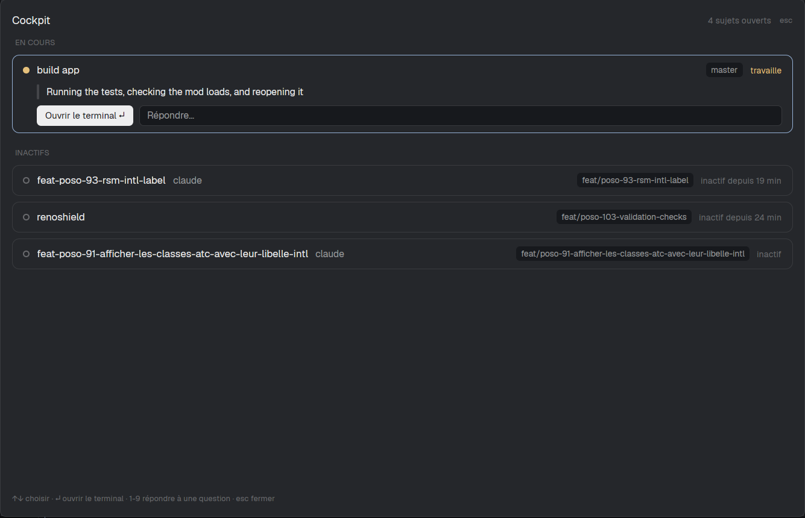

# herdr-config

Ma configuration de [Herdr](https://herdr.dev). Le repo vit directement dans `~/.config/herdr-app`. Le `.gitignore` ne suit que mes fichiers, et laisse de côté tout ce que Herdr écrit lui-même : l'état de la fenêtre, les mods et layouts fournis par l'app, les types générés.

| Fichier | Rôle |
|---|---|
| `keys.json` | mes raccourcis (`ctrl-shift-j` ouvre start-work) |
| `settings.json` | mes réglages |
| `mods/start-work/` | la fenêtre « Commencer un travail » |
| `install.sh` | installe et vérifie ce dont les mods ont besoin |
| `mods/clean-merged/` | le panneau qui supprime les branches et worktrees des PR mergées (`ctrl-shift-m`) |
| `mods/pr-inbox/` | les PR GitHub qui m'attendent : un tiroir sur le bord droit, un toast quand une review tombe, et un Claude lancé sur la PR (`ctrl-shift-g`) |
| `layouts/mine.json` | mon layout : `main` plus le tiroir des PR |
| `mods/cockpit/` | tous les Claude sur un écran, ceux qui m'attendent en premier, avec leur dernière phrase (`ctrl-shift-a`) |

## start-work

`ctrl-shift-j`, depuis un terminal ouvert dans un repo :

| Jira : POSO-90 a déjà sa branche et sa PR, Créer devient Reprendre | GitHub : les issues du repo |
|---|---|
|  |  |

- l'onglet **Jira** liste les tickets ouverts du repo (voir plus bas d'où ils viennent) : d'abord les miens, puis ceux sans personne, puis ceux des autres. Une clé tapée en entier (`POSO-110`) est cherchée dans tout Jira ;
- l'onglet **GitHub** liste les issues ouvertes du repo ;
- `tab` passe d'un onglet à l'autre. Taper `#12` ouvre GitHub, une clé ouvre Jira. Un texte libre donne un travail « sans ticket ».

**Créer** fait un worktree dans `~/.herdr/worktrees/<repo>/<branche>`, à partir de `origin/HEAD`. Il ouvre dessus un espace avec Claude. Pour un ticket Jira qui n'est pas à moi, la case « M'assigner » (cochée par défaut) me l'assigne, et le passe « En cours » s'il était encore à faire.

Si le ticket a déjà une branche ou une PR ouverte, le bouton devient **Reprendre** : il ouvre cette branche au lieu d'en créer une, ou affiche l'espace qui est déjà dessus.

La première fois qu'on ouvre un repo, l'onglet Jira demande où sont ses tickets, et la réponse est gardée dans `mods/start-work/config.json`. Un repo peut en avoir plusieurs : sous les onglets, « Tickets de : » les liste. Un clic sur l'un le modifie, × le retire, « + ajouter » en ajoute un, et leurs tickets s'affichent ensemble. On peut donner :

| Réponse | Tickets montrés |
|---|---|
| le lien d'un board de projet (`…/projects/POSO/boards/1802`) ou la clé (`POSO`) | ceux du sprint ouvert du projet, ou tous ses tickets ouverts s'il n'a pas de sprint (kanban) |
| le lien d'un filtre (`…/issues/?filter=10782`) | les tickets ouverts du filtre |
| du JQL (`labels = DATADELTA`) | les tickets ouverts qu'il trouve |

On choisit le board qu'on veut. Pour un board qui n'appartient pas à un projet (Table Ronde : `…/people/…/boards/96`), on colle le lien de son filtre, ce sont les mêmes tickets : sur le board, ⋯ → Paramètres du tableau → Filtre → Modifier la requête de filtre. acli ne sait pas retrouver ce filtre à partir du board. Pour n'avoir que la part d'un repo dans un grand board, du JQL suffit (`labels = DATADELTA`). `config.json` donne aussi le format des branches de certains repos :

```json
"jira": { "renoshield": "https://vidalgroup.atlassian.net/jira/software/projects/POSO/boards/1802", "data-delta": ["labels = DATADELTA", "https://vidalgroup.atlassian.net/issues/?filter=10782"] },
"branch_formats": { "renoshield": "feat/{key}-{slug}" }
```

Dans un format, `{KEY}` vaut `POSO-12`, `{key}` vaut `poso-12` et `{slug}` est le titre du ticket. Sans format, une branche s'appelle `POSO-12-titre`.

## clean-merged

`ctrl-shift-m`, depuis un terminal ouvert dans un repo, liste ses branches locales dont la PR GitHub est mergée. `↵` supprime celles qui sont cochées, avec leur worktree et l'espace Herdr ouvert dessus.


- cochées d'office : tous leurs commits sont dans la PR. Les squash merges sont gérés : la branche est comparée au head de la PR, pas à `main` ;
- décochées : la branche a des commits absents de la PR (travail ajouté après le merge, ou branche rebasée depuis). On peut les cocher quand même ;
- grisées : le worktree a des changements non commités, ou un agent travaille dans son espace.

La branche par défaut et celle du checkout principal ne sont jamais proposées.

## cockpit

`ctrl-shift-a` : chaque Claude ouvert sur une carte, en trois sections, nommées comme dans la barre latérale de Herdr. **Needs you** (`blocked` ou `done`) en premier, puis **Working**, puis **Idle**. Une carte donne l'espace, la branche, depuis combien de temps l'agent est dans cet état, et son dernier message, ou ce qu'il fait en ce moment s'il travaille.

Un dernier message peut être long : la carte en montre le début (260 caractères, sans le markdown) et, s'il a été coupé et que le message finit par une question, cette question à la suite. Le reste se lit dans le terminal.



- `↑↓` choisit une carte, `↵` ouvre son terminal, `esc` ferme ;
- un agent qui a posé une question avec des choix (`AskUserQuestion`) les affiche en boutons : `1`-`9` ou un clic répond sans ouvrir le terminal ;
- un agent inactif ou terminé a un champ « Répondre… » : le texte lui est envoyé comme un message ;
- un agent bloqué sur autre chose qu'une question (une permission, un dialogue) ne se pilote que depuis son terminal.

La dernière phrase vient du transcript de la session Claude, sans hook : herdr-core connaît le processus au premier plan du terminal, Claude écrit `~/.claude/sessions/<pid>.json` qui nomme la session, et la fin de `~/.claude/projects/<dossier>/<session>.jsonl` donne le dernier message, l'heure du dernier tour et la question en attente. Seulement les Claude de cette machine.

## pr-inbox

Un tiroir flottant sur le bord droit de la fenêtre (layout `mine`) : replié, 52 px, un compteur par section et un point par PR ; il s'ouvre au survol. `ctrl-shift-g`, ou un clic sur une ligne, ouvre le dialogue.

| Le tiroir, ouvert | Le dialogue |
|---|---|
|  |  |

Trois sections, tous repos confondus :

| Section | D'où ça vient |
|---|---|
| **À relire** : les PR des autres où ma review est demandée | `gh search prs --review-requested=@me` |
| **Retour sur mes PR** : mes PR avec une review ou un commentaire pas encore lu | `gh api notifications` |
| **Mes PR en attente** : mes autres PR ouvertes (en vert : approuvée) | `gh search prs --author=@me` |

Le tiroir interroge GitHub toutes les 90 s. Une notification jamais vue donne un toast (« X te demande une review », « Y a relu #N ») ; le cliquer ouvre le dialogue sur la PR. Au premier lancement rien n'est signalé : ce qui existait déjà est marqué vu.

Le dialogue : la liste à gauche, la PR à droite, avec sa branche, sa CI, ses fichiers, puis chaque review avec son verdict et ses commentaires `fichier:ligne`, en lecture seule. Répondre se fait sur GitHub (« Ouvrir sur GitHub ↗ »). « Marquer lu » marque lues les notifications de la PR.

- `↑↓` choisit, `↵` lance, `esc` ferme ;
- **▶ Relire avec Claude**, sur une PR à relire : la branche est sortie dans un worktree (`pull/<n>/head` pour un fork), un espace ouvert dessus, et Claude lancé avec « relis la PR #N avec le skill code-review, prépare la review dans ce terminal, ne poste rien » ;
- **▶ Traiter les remarques avec Claude**, sur un retour : l'espace déjà ouvert sur la branche est réutilisé, et Claude reçoit les remarques recopiées en entier, avec `superpowers:receiving-code-review` : il vérifie chaque remarque, corrige en commits `--fixup`, et ne répond pas sur GitHub.

**Claude prépare, moi je poste** : le mod n'écrit jamais sur GitHub, sauf « marquer lu ». La ligne sous les boutons dit ce que `↵` va faire avant qu'on appuie.

Le dépôt local d'une PR est retrouvé par l'`origin` des espaces ouverts et des worktrees du repo ; s'il n'y en a pas, le mod demande le dossier et le garde dans `mods/pr-inbox/config.json` :

```json
"repos": { "softwarevidal/renoshield": "/home/moi/IdeaProjects/renoshield" }
```

## Prérequis

```bash
~/.config/herdr-app/install.sh
```

Le script :

- vérifie `git` ;
- vérifie `gh` et le connecte si besoin ;
- installe `acli`, le CLI officiel d'Atlassian, dans `~/.local/bin` (Linux, sans sudo) s'il manque, puis le connecte à Jira avec `acli jira auth login --web` (OAuth dans le navigateur, sans token) ;
- lance `herdr-app check` sur chaque mod.

On peut le relancer sans risque.

## Sur une autre machine

`~/.config/herdr-app` existe déjà dès que Herdr a été lancé une fois. On y récupère donc le repo, sans cloner par-dessus :

```bash
cd ~/.config/herdr-app
git init -b main && git remote add origin <url-du-repo>
git fetch origin && git checkout -f main
./install.sh
```

Puis `ctrl-shift-l` jusqu'au layout `mine`, celui qui porte le tiroir des PR.

## Installer start-work

Pour ajouter seulement le mod à son Herdr, sans les raccourcis ni les réglages de ce repo. Deux façons.

### En demandant à son agent

Comme sur [herdr.dev/mods](https://herdr.dev/mods), on copie une ligne à son agent dans Herdr. Il suit la procédure du guide de Herdr (`~/.config/herdr-app/AGENTS.md`) : lire chaque fichier avant d'ajouter le mod, le copier sans écraser un mod du même nom, ajouter la touche en demandant avant d'en remplacer une, puis lancer `herdr-app check`.

```text
Read ~/.config/herdr-app/AGENTS.md, then add this mod: github.com/aguiddir/herdr-config/tree/main/mods/start-work. Bind ctrl-shift-j to mod.open:start-work. It needs gh and acli (Atlassian's CLI) logged in: run install.sh from that repo. Then ask me which of my repos map to which Jira project for its config.json.
```

### À la main


```bash
git clone https://github.com/aguiddir/herdr-config.git ~/herdr-config
cp -r ~/herdr-config/mods/start-work ~/.config/herdr-app/mods/
~/herdr-config/install.sh   # installe acli, connecte gh et acli, vérifie le mod
```

Puis ajouter le raccourci dans la section `global` de `~/.config/herdr-app/keys.json` :

```json
"ctrl-shift-j": "mod.open:start-work"
```

Pour l'onglet Jira, ajouter son repo et son projet dans `~/.config/herdr-app/mods/start-work/config.json` (voir plus haut).

Pour mettre à jour : `git -C ~/herdr-config pull`, puis refaire le `cp`. Il remplace `config.json` : y remettre ses repos s'il en a ajouté.
